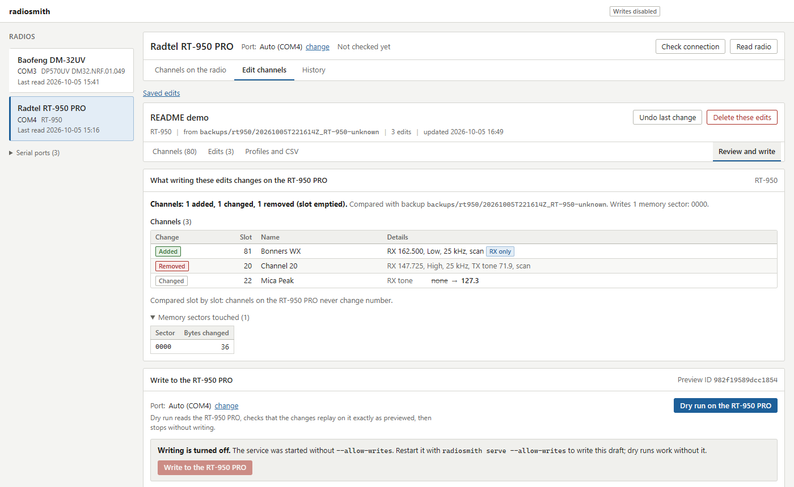
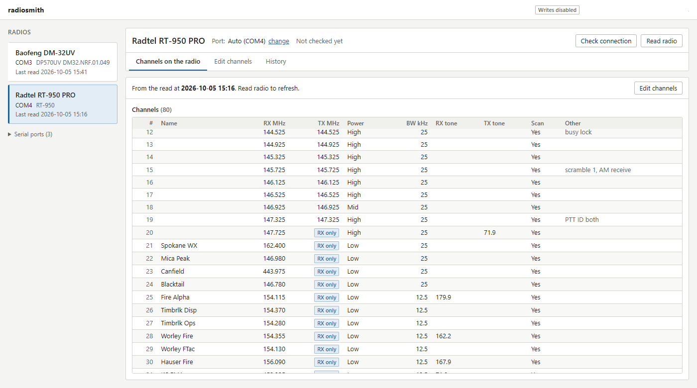
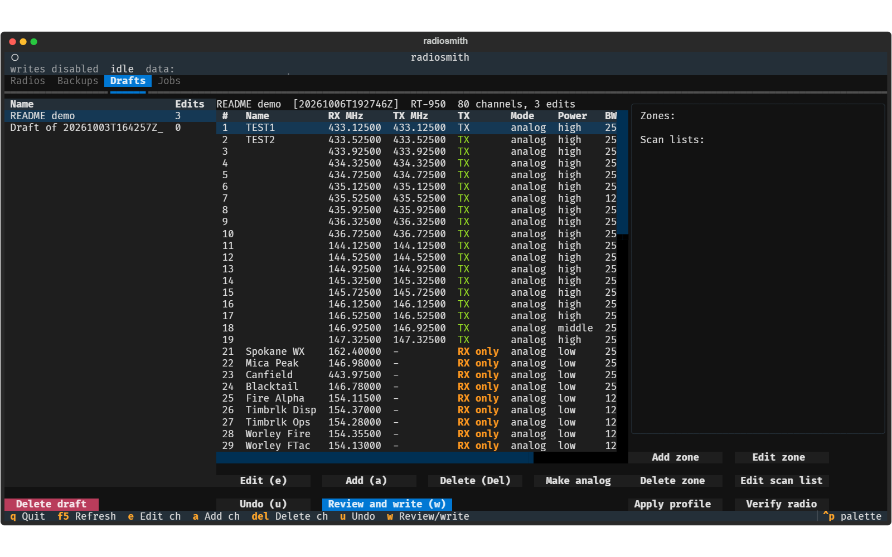

# radiosmith

Program a Baofeng DM-32UV or Radtel RT-950 PRO from a web browser, a terminal,
or an AI assistant over MCP. One local service owns the serial ports; every
write is previewed first and verified by reading the radio back. Runs on
Windows, macOS and Linux.

<picture>
  <source media="(prefers-color-scheme: dark)" srcset="docs/images/web-review-dark.png">
  
</picture>

## Features

- Read each radio into a checksummed backup.
- Edit channels (and on the DM-32UV, zones and scan lists) offline as a
  draft, with undo. Drafts never touch the radio.
- See exactly what a write will change, down to the memory pages or sectors,
  before anything is sent.
- Writes replay the draft on a fresh read, touch only the changed memory, and
  are checked against a full read-back.
- Add sets of channels from JSON profiles, or round-trip channels through CSV.
- Web interface, terminal interface and MCP server, all on the same local
  service.

## Quick start

You need [uv](https://docs.astral.sh/uv/) and the driver for your programming
cable. Both radios use CH340 cables: Windows usually installs the driver
itself; on macOS you may need the WCH CH34x driver; on Linux, add yourself to
the `dialout` group.

```sh
uv sync
uv run radiosmith ports    # find your cable
uv run radiosmith serve    # open http://127.0.0.1:8765/
```

Pick your radio, read it, then edit a draft and review the changes. Writing is
off until you restart with `uv run radiosmith serve --allow-writes`. For the
terminal interface, run `uv run radiosmith tui`.

To use it from Claude Code (or another MCP client), with the service running:

```sh
claude mcp add --transport http radiosmith http://127.0.0.1:8765/mcp
```

See [docs/USAGE.md](docs/USAGE.md) for every command, the MCP tools, profiles
and CSV.

## Screenshots

Channels read from the RT-950 PRO:

<picture>
  <source media="(prefers-color-scheme: dark)" srcset="docs/images/web-channels-dark.png">
  
</picture>

The terminal interface, editing a draft:



## Supported radios

| Radio | Firmware | Read | Write |
| --- | --- | --- | --- |
| Baofeng DM-32UV (DP570UV) | DM32.NRF.01.049 | yes | channels, zones, scan lists |
| Radtel RT-950 PRO | not reported over serial; decoding matches vendor CPS v1.3.3 | yes | channels |

Both were tested with CH340 cables on Windows 11. Other firmware versions are
untested. Close the vendor CPS, CHIRP or any other program using the port
first.

## Safety

radiosmith never writes calibration or firmware, refuses any command outside a
per-radio allowlist, and backs up the whole radio before and after every
write. Details: [docs/SAFETY.md](docs/SAFETY.md).

Transmitting needs the right license for the band. The example profiles are
receive-only.

## Development

```sh
uv run pytest              # no hardware needed: tests use simulated radios
uv run ruff check src tests
```

The web interface source is in `web/` (Svelte); the built copy in
`src/radiosmith/web_dist/` is committed, so running radiosmith needs no Node.
To work on it: `cd web && npm install && npm run dev`, then `npm run build`.

## License

MIT License; see [LICENSE](LICENSE).
